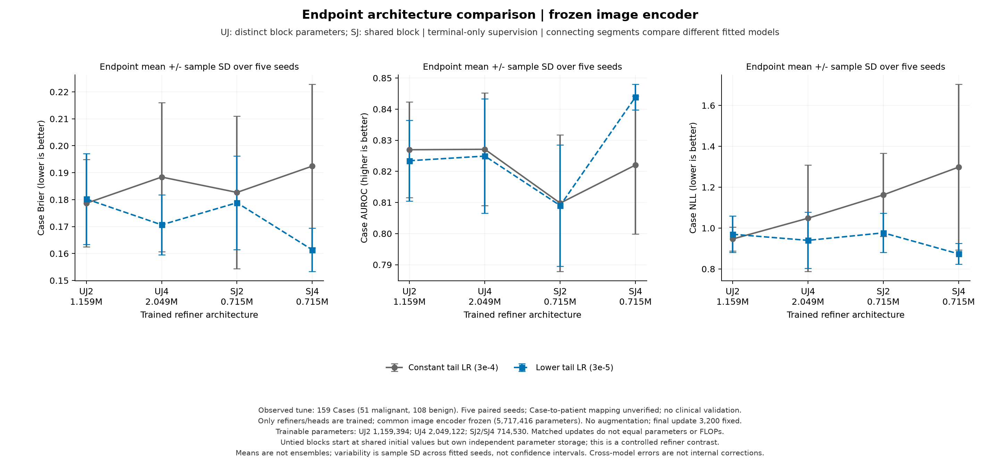
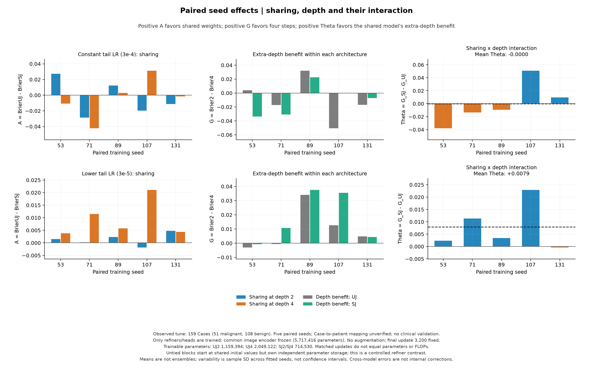
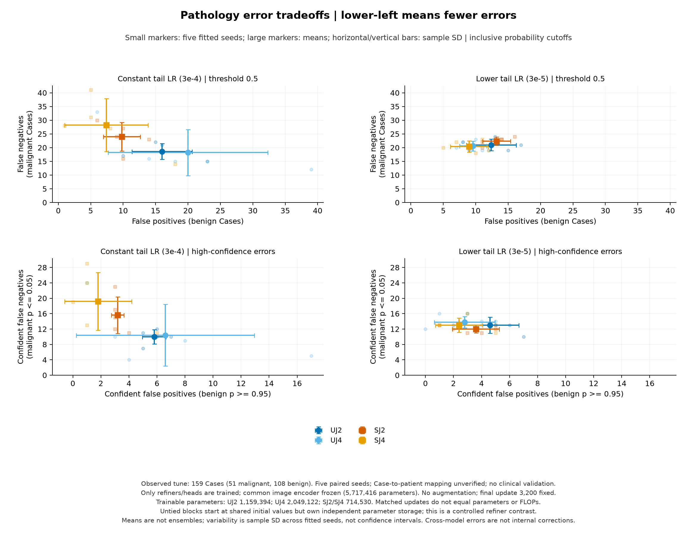

# CPU 探索结果：普通与循环 Transformer 的深度对照

结果日期：2026-10-11。根据执行前方案，复用20个已验证共享模型终点，补齐20个普通独立参数模型终点。固定256训练Case、159已观察开发Case、5个配对种子和两种末期学习率政策。所有读出均使用各自训练深度的固定最终终点，核心源码保持原指纹。

**完成后的判断：保留“训练配方相关的共享四步概率优势”作为候选发现，暂缓实际病灶干预。** low_tail下SJ4相对UJ4的原概率Brier改善0.00930，5/5种子同向；条件95% Case区间为[-0.00638,+0.02408]。但两组0.5阈值的恶性漏判/良性误判几乎相同，共享×深度交互也仍不确定。constant下共享四步则明显把“更多恶性漏判”与“更少良性误判”一起带来。这些结果尚不足以把差异归因于循环更有效地读取病灶信息。

UJ表示普通独立参数模块、SJ表示共享循环模块；本轮四组都使用末步分类与分割联合训练。Brier衡量预测概率与真实良恶性标签的平方误差，越小越好；它的改善不是准确率提高相同百分点。

## 四组与训练政策

| 模型 | 模块执行次数 | 独立模块数 | 可训练参数 | 含共同冻结编码器的总参数 |
|---|---:|---:|---:|---:|
| 普通2 | 2 | 2 | 1,159,394 | 6,876,810 |
| 普通4 | 4 | 4 | 2,049,122 | 7,766,538 |
| 循环2 | 2 | 1 | 714,530 | 6,431,946 |
| 循环4 | 4 | 1 | 714,530 | 6,431,946 |

两种政策前20轮/2560更新均3e−4。最后5轮/640更新constant仍3e−4，low_tail固定3e−5。统一第25轮/3200更新，无最佳epoch、种子或政策选择。UJ每层初值等于配对SJ共享层，参数存储独立，heads/归一化初值及Case/视图抽样相同。共享与非共享两种深度都分别训练；不是四步模型中间读出与终点比较。

训练集174良性/82恶性、445图，开发集108良性/51恶性、281图。所有模型使用同一冻结DeiT-Tiny、无增强、末步分类与分割联合损失。这个实验比较冻结编码器后的附加模块，不是端到端普通ViT与全循环ViT，也没有统一参数预算、完整FLOPs或最佳调优预算。

## 固定终点性能

| 政策 | 模型 | Brier ↓ | AUROC ↑ | NLL ↓ | Dice ↑ | 敏感度 / 特异度（0.5） |
|---|---|---:|---:|---:|---:|---:|
| constant | UJ2 | 0.1787 ± 0.0162 | 0.8269 ± 0.0154 | 0.9464 ± 0.0579 | 0.7504 ± 0.0115 | 0.6353 / 0.8519 |
| constant | UJ4 | 0.1884 ± 0.0277 | 0.8271 ± 0.0181 | 1.0483 ± 0.2604 | 0.7539 ± 0.0119 | 0.6431 / 0.8148 |
| constant | SJ2 | 0.1827 ± 0.0283 | 0.8098 ± 0.0220 | 1.1626 ± 0.2029 | 0.7380 ± 0.0217 | 0.5294 / 0.9093 |
| constant | SJ4 | 0.1924 ± 0.0304 | 0.8220 ± 0.0222 | 1.2983 ± 0.4054 | 0.7426 ± 0.0101 | 0.4471 / 0.9315 |
| low_tail | UJ2 | 0.1802 ± 0.0168 | 0.8234 ± 0.0130 | 0.9698 ± 0.0893 | 0.7594 ± 0.0070 | 0.5882 / 0.8852 |
| low_tail | UJ4 | 0.1707 ± 0.0112 | 0.8249 ± 0.0184 | 0.9399 ± 0.1374 | 0.7647 ± 0.0087 | 0.5961 / 0.9111 |
| low_tail | SJ2 | 0.1789 ± 0.0174 | 0.8090 ± 0.0195 | 0.9767 ± 0.0963 | 0.7577 ± 0.0039 | 0.5608 / 0.8778 |
| low_tail | SJ4 | 0.1614 ± 0.0080 | 0.8439 ± 0.0041 | 0.8738 ± 0.0509 | 0.7603 ± 0.0056 | 0.6000 / 0.9167 |

均值±样本标准差描述5个分别训练的网络，不是预测集成或置信区间。Brier使用原概率，报告NLL以epsilon1e−15裁剪；本轮未新增温度拟合或阈值搜索。

## 直接架构收益与深度交互

A = Brier_UJ − Brier_SJ，正值有利共享；G_arm = Brier₂ − Brier₄，正值有利四步；Theta = G_SJ − G_UJ，正值表示共享的深度收益更大。Theta为正不自动证明SJ4优于UJ4。

| 政策 | 两步共享收益A₂ | 条件Case区间 | 四步共享收益A₄ | 条件Case区间 |
|---|---:|---|---:|---|
| constant | -0.00403 | [-0.02500, +0.01717] | -0.00406 | [-0.03260, +0.02385] |
| low_tail | +0.00139 | [-0.01397, +0.01772] | +0.00930 | [-0.00638, +0.02408] |

| 政策 | 普通深度收益G_UJ | 条件区间 | 循环深度收益G_SJ | 条件区间 | Theta | 条件区间 |
|---|---:|---|---:|---|---:|---|
| constant | -0.00973 | [-0.02725, +0.00801] | -0.00976 | [-0.02967, +0.01060] | -0.00003 | [-0.02409, +0.02218] |
| low_tail | +0.00958 | [-0.00748, +0.02862] | +0.01749 | [+0.00171, +0.03376] | +0.00791 | [-0.01479, +0.02849] |

| 政策 | 种子 | A₂ | A₄ | G_UJ | G_SJ | Theta |
|---|---:|---:|---:|---:|---:|---:|
| constant | 53 | +0.02719 | -0.01070 | +0.00401 | -0.03388 | -0.03789 |
| constant | 71 | -0.02871 | -0.04221 | -0.01737 | -0.03087 | -0.01350 |
| constant | 89 | +0.01232 | +0.00293 | +0.03206 | +0.02266 | -0.00939 |
| constant | 107 | -0.01964 | +0.03123 | -0.05055 | +0.00032 | +0.05087 |
| constant | 131 | -0.01131 | -0.00156 | -0.01680 | -0.00705 | +0.00975 |
| low_tail | 53 | +0.00151 | +0.00382 | -0.00303 | -0.00071 | +0.00232 |
| low_tail | 71 | +0.00022 | +0.01152 | -0.00054 | +0.01076 | +0.01130 |
| low_tail | 89 | +0.00232 | +0.00574 | +0.03410 | +0.03752 | +0.00342 |
| low_tail | 107 | -0.00184 | +0.02106 | +0.01263 | +0.03553 | +0.02291 |
| low_tail | 131 | +0.00476 | +0.00436 | +0.00475 | +0.00436 | -0.00039 |

low_tail的A₄在5/5种子为正，逐一去掉一个种子后仍为正；A₂仅+0.00139。SJ4相对UJ4的AUROC均值提升0.01899，但仅4/5种子同向；NLL收益+0.06618的条件区间[-0.05504,+0.19876]跨零，Dice均值反而下降0.00437，区间[-0.01102,+0.00148]。所以这是概率/排序候选信号，没有统一的分割与诊断收益。

**增加深度的收益也依赖训练政策。** constant下普通与共享的G均约−0.0097；low_tail下两者都转为正。普通四层由constant切到low_tail的Brier均值改善0.01772，共享四步改善0.03108。这说明此前“降低末期学习率恢复循环四步收益”的现象中，包含普通四层也有的训练政策效应。当前Theta不足以确认共享获得额外的深度收益；改变AdamW学习率同时改变梯度更新及解耦权重衰减的步长，不能单独归因于某个动力学机制。

**病例集中度仍影响效应量。** low_tail A₄的五种子平均病例效应有96个为正、63个为负，最大的5个正收益病例贡献总正收益的26.48%。仅作敏感性诊断地移除这5个后，A₄由+0.00930缩小为+0.00112。Theta按同样规则由+0.00791变为−0.00230。主分析始终保留全部159 Case；这个检查不能用于筛选后续干预病例，也不说明被移除病例异常。

## 按真实标签拆开的错误

| 政策 | 模型 | 恶性假阴性 / 51 | 良性假阳性 / 108 | 高置信假阴性 | 高置信假阳性 |
|---|---|---:|---:|---:|---:|
| constant | UJ2 | 18.6 ± 2.9 | 16.0 ± 4.6 | 10.0 ± 1.9 | 5.8 ± 0.8 |
| constant | UJ4 | 18.2 ± 8.4 | 20.0 ± 12.3 | 10.4 ± 8.0 | 6.6 ± 6.3 |
| constant | SJ2 | 24.0 ± 5.2 | 9.8 ± 2.9 | 15.6 ± 4.8 | 3.2 ± 0.4 |
| constant | SJ4 | 28.2 ± 9.7 | 7.4 ± 6.4 | 19.2 ± 7.5 | 1.8 ± 2.4 |
| low_tail | UJ2 | 21.0 ± 2.1 | 12.4 ± 3.8 | 13.0 ± 2.1 | 4.6 ± 2.1 |
| low_tail | UJ4 | 20.6 ± 1.8 | 9.6 ± 2.1 | 13.8 ± 1.5 | 2.8 ± 2.2 |
| low_tail | SJ2 | 22.4 ± 1.5 | 13.2 ± 2.2 | 12.0 ± 1.0 | 3.6 ± 1.7 |
| low_tail | SJ4 | 20.4 ± 2.1 | 9.0 ± 2.9 | 13.0 ± 1.9 | 2.4 ± 1.7 |

表中计数是5个模型各自Case计数的均值±种子标准差，不能相加当作独立患者人数。恶性p<0.5是假阴性，良性p≥0.5是假阳性；高置信恶性错误p≤0.05、良性错误p≥0.95（含边界）。固定0.5不是已验证的临床操作点。

| 政策 | 深度 | 真实标签 | UJ→SJ错变对 | UJ→SJ对变错 | 净错误率改善 | 条件同类Case区间 |
|---|---:|---|---:|---:|---:|---|
| constant | 2 | malignant | 1.6 | 7.0 | -0.10588 | [-0.15686, -0.05490] |
| constant | 2 | benign | 8.0 | 1.8 | +0.05741 | [+0.03148, +0.08704] |
| constant | 4 | malignant | 0.8 | 10.8 | -0.19608 | [-0.25882, -0.13725] |
| constant | 4 | benign | 15.6 | 3.0 | +0.11667 | [+0.08329, +0.15000] |
| low_tail | 2 | malignant | 3.6 | 5.0 | -0.02745 | [-0.07843, +0.03137] |
| low_tail | 2 | benign | 3.8 | 4.6 | -0.00741 | [-0.02963, +0.01296] |
| low_tail | 4 | malignant | 3.8 | 3.6 | +0.00392 | [-0.03922, +0.04706] |
| low_tail | 4 | benign | 4.8 | 4.2 | +0.00556 | [-0.02222, +0.03148] |

完整逐种子同深度UJ→SJ、同架构2→4和同架构/深度constant→low_tail转换、概率及Brier/NLL变化均在公开汇总中。所有转换属于不同训练模型/政策输出的比较，不能称为同一模型的内部纠错。标签分组区间只在51恶性或108良性Case内重采样。

constant四步从UJ改为SJ，平均恶性漏判由18.2升至28.2，良性误判由20.0降至7.4。恶性中0.8例错变对、10.8例对变错；恶性错误率净改善−0.19608，条件区间[-0.25882,−0.13725]。恶性漏判增加出现在4/5种子；高置信恶性错误由10.4升至19.2，5/5种子都增加。

同一对照的恶性Brier收益为−0.17100，区间[-0.21857,−0.12544]，5/5种子恶化；良性Brier收益为+0.07477，区间[+0.05305,+0.09691]。108/159的良性权重与51/159的恶性权重把这两个方向相反的效应合成总体A₄≈−0.00406。只看总分会掩盖明显的类别取舍。SJ−UJ平均恶性概率在恶性中下降0.17441，在良性中下降0.09509；恶性5/5种子下降，良性仅3/5种子下降。

low_tail四步则平均漏判20.6→20.4、误判9.6→9.0；恶性3.8例错变对、3.6例对变错，良性4.8例错变对、4.2例对变错。两类净错误率区间均跨零，当前固定阈值下没有清楚的错误数收益。恶性与良性Brier收益分别为+0.01555、+0.00635，两类区间也均跨零。

这些输出变化与分数/操作偏置解释相容，尚未证明偏置解释了全部架构差异，也没有定位病灶证据来源。正温度缩放保持0.5分类决策，不能单凭温度解释或消除上述漏判/误判变化。

## 是否值得继续做病灶干预

**本轮决定：暂缓实际病灶干预，完成当前结果归档。** 判断基于完整模式：low_tail共享四步有5个种子一致的Brier候选优势，但固定阈值错误数接近；constant下有强烈且不利于恶性识别的类别取舍，这个取舍在low_tail下基本消失；普通模型的深度收益也随政策翻转；共享×深度交互及病例集中度仍限制解释。条件区间跨零是其中一条证据，没有被用作自动立项/否决门槛。

现在保留的探索问题是：**共享约束是否在某些训练配方下带来概率或排序收益，这种收益在统一操作点比较后是否仍存在？** 本实验已支持把训练政策作为架构研究的一部分，但尚不能把研究主张升级为“共享循环读取病灶更充分”或“改善临床判断”。

若另行启动下一阶段，先为全部四组锁定统一的概率与操作点诊断：采用相同交叉拟合规则，在未参与校准/阈值选择的折上比较，并同时保留AUROC、类别概率损失、同敏感度下的特异度及错误变化。这个步骤仍是已观察开发集上的诊断；它不会替代患者分组核实和独立验证。本轮没有执行这一步。

若这之后仍有值得解释的架构差异，再制定病灶/周边/匹配背景和假干预对照，使用全部预先定义的合格病例、固定模型与匹配面积/扰动规则，并区分人工扰动的分布变化和真实证据利用；不能只挑循环获益或犯错的病例。

## 执行与复核

- 执行前方案与配置已在提交`9a5cb75066f876db89a380e322c1fecc3ecefc45`锁定；分析/绘图实现发布于`142ed178988909f7393513c6fde8a6fc03d1ccc5`。核心训练源码指纹保持`c3a1d28753504f5751d97db125c7a6515ae2db025d68ae15f72b5f1e085dc317`。
- 两个CPU训练worker均正常退出，分别完成5个普通两层前缀及10个尾段、5个普通四层前缀及10个尾段。10个新前缀×2560更新+20个新尾段×640更新=38,400实际新增更新；20个共享终点是既有配对参照。
- worker记录耗时分别751.68秒、982.41秒，包含各自训练、评估与文件处理，两者并发；不能把它们相加当总墙钟，或据此声称架构推理加速。
- 全套代码验证547个测试及41个子测试通过（16.29秒）；错误图统一坐标后的23个绘图测试通过（0.34秒）。三张实际PNG均已目视检查；可安装模块与当前源码哈希一致。
- 根助手从40份原始开发预测独立复算终点与类别指标，并复算110组Brier/错误/概率效应及2000次区间；另一独立审查者复算154组配对总体/类别效应，并验证20份完整前缀状态（10份新UJ+10份绑定SJ）、40个终点来源/抽样/对齐、旧SJ精确重放链、集中度及逐种子敏感性。均通过，没有将复核次数计为新模型或新样本。
- 所有40个终点、10个新前缀的公开汇总与本地汇总一致；公开导出仅含配置、哈希、聚合指标和科学图。执行详情在[执行记录](../reports/architecture256/execution_summary.json)，独立指标检查在[复核汇总](../reports/architecture256/independent_metrics_audit.json)。

本报告的性能与效应比较来自已经观察的开发Case，患者映射仍未核实。整体区间先在Case内平均5个种子配对效应，再重采样159Case，2000次、种子17；标签分组使用相同规则但各自分母。区间条件于这些固定网络/病例，不覆盖训练种子总体或独立患者总体不确定性。统计比较和病灶阶段判断均为探索，没有自动门槛。

概率尺度尚未用统一新增校准流程完全排除；共享约束、不同可训练容量、相同梯度裁剪和固定优化配方都限制机制归因。模型没有获取新视图，分割标注只参与训练监督，不作为forward输入；分割变好本身不是良恶性预测或临床效用证据。

本阶段未执行图像扰动、打开cal/test、增加病例或运行GPU。原始图像、Case/视图身份、逐Case预测、完整训练状态与权重保留本地。公开[执行前方案](CPU_ARCHITECTURE256_PLAN.md)、[配置](../configs/cpu_architecture256.json)、[汇总与图](../reports/architecture256/)、[执行记录](../reports/architecture256/execution_summary.json)。
