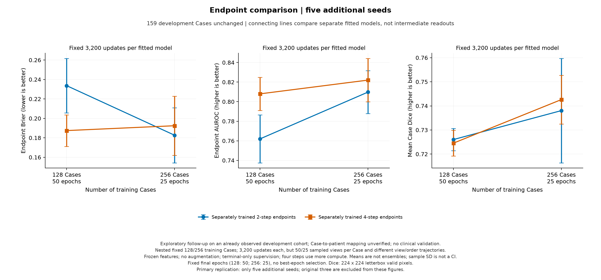
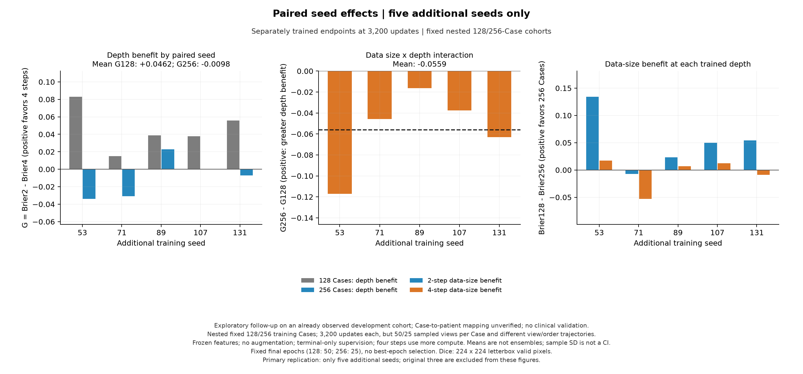
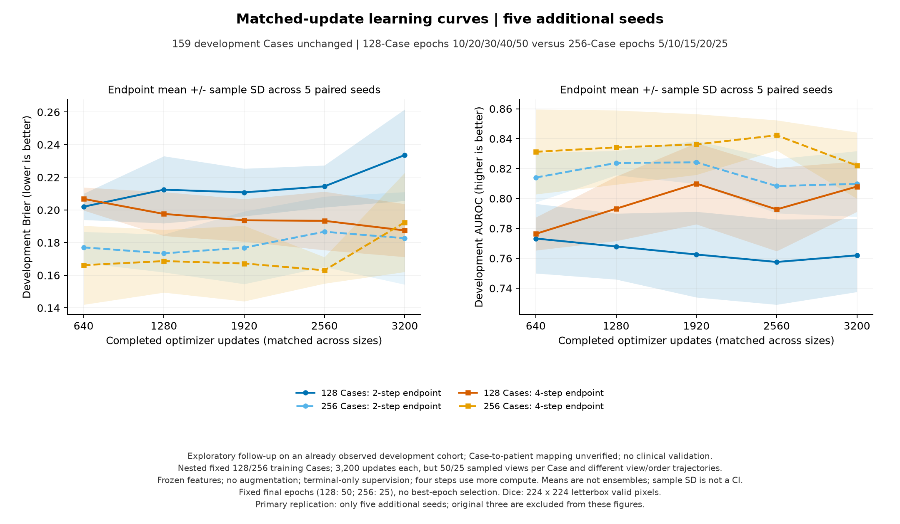

# 256 Case CPU 五种子复核：独立深度与配对数据规模

结果日期：2026-10-11。新增53/71/89/107/131五个种子、两步/四步、末步联合监督，共十次全新CPU拟合。本报告主结果只使用这五个新增种子，配对到它们各自已有的十个128 Case模型。旧17/29/43单独报告，八种子汇总明确标为次要描述。

**十次新增CPU训练全部完成。新增五种子中四步仅2/5的Brier更好，平均G₂₅₆为−0.00976，条件区间跨零；八种子次要汇总为4好/4差，平均接近零。128阶段的额外循环优势没有在这一256 Case固定预算配方中稳定复现。两步的病例扩充Brier收益更明显，四步的诊断概率改善不一致；这不是循环架构普遍无效或纯数据量因果效应的证明。**

## 固定终点的主结果

256 Case训练25 epoch，128参照保留50 epoch，均完成3,200 updates、6,400次Case接触。开发集仍为同一159 Case。均值±样本标准差描述五个独立拟合，未做预测集成。

| 训练Case | 深度 | Brier ↓ | AUROC ↑ | NLL ↓ | Dice ↑ | 平均敏感度 / 特异度（0.5） |
|---|---|---:|---:|---:|---:|---:|
| 128 | 2步 | 0.2336 ± 0.0280 | 0.7620 ± 0.0244 | 1.4752 ± 0.3758 | 0.7260 ± 0.0046 | 0.6039 / 0.7611 |
| 128 | 4步 | 0.1875 ± 0.0162 | 0.8080 ± 0.0168 | 1.1735 ± 0.1766 | 0.7245 ± 0.0054 | 0.5059 / 0.8944 |
| 256 | 2步 | 0.1827 ± 0.0283 | 0.8098 ± 0.0220 | 1.1626 ± 0.2029 | 0.7380 ± 0.0217 | 0.5294 / 0.9093 |
| 256 | 4步 | 0.1924 ± 0.0304 | 0.8220 ± 0.0222 | 1.2983 ± 0.4054 | 0.7426 ± 0.0101 | 0.4471 / 0.9315 |

Brier与NLL评价概率质量，AUROC评价良恶性排序，Dice评价轮廓；它们不能互相替代，也不能单独证明临床效用。

## 额外循环与数据规模交互

G = 独立两步最终Brier−独立四步最终Brier，正值有利于四步；G₂₅₆−G₁₂₈按同一个种子与开发Case配对。

| 种子 | 256两步Brier | 256四步Brier | G₂₅₆ | G₁₂₈ | G₂₅₆−G₁₂₈ | NLL₄−NLL₂（256） |
|---|---:|---:|---:|---:|---:|---:|
| 53 | 0.13874 | 0.17262 | -0.03388 | +0.08312 | -0.11700 | +0.11934 |
| 71 | 0.21136 | 0.24223 | -0.03087 | +0.01499 | -0.04586 | +0.47886 |
| 89 | 0.19037 | 0.16771 | +0.02266 | +0.03894 | -0.01628 | -0.06499 |
| 107 | 0.20008 | 0.19976 | +0.00032 | +0.03792 | -0.03760 | +0.23189 |
| 131 | 0.17285 | 0.17991 | -0.00705 | +0.05594 | -0.06299 | -0.08648 |

G₂₅₆平均-0.00976，条件Case 95%区间[-0.02967, +0.01060]。

G₁₂₈平均+0.04618，条件Case 95%区间[+0.01682, +0.07611]。

G₂₅₆−G₁₂₈平均-0.05595，条件Case 95%区间[-0.08686, -0.02616]。

256 NLL₄−NLL₂平均+0.13573，条件Case 95%区间[-0.02446, +0.30046]。

256 Dice₄−Dice₂平均+0.00457，条件Case 95%区间[-0.00486, +0.01443]。

新增五个种子的G₂₅₆为正2个、负3个。删去任一种子后的平均G₂₅₆：删53：-0.00373；删71：-0.00449；删89：-0.01787；删107：-0.01228；删131：-0.01044。这些量用于描述，不套用128阶段的旧筛选门槛。

在新增五个匹配种子中，G₂₅₆−G₁₂₈全部为负，且条件区间不含零，说明这组已拟合模型的深度收益随本轮固定预算扩充而减弱。这个比较同时改变数据多样性、重复次数与抽样轨迹，不能将原因单独归给数据量，也不能外推到训练种子总体。四步平均AUROC仍略高于两步，而Brier/NLL更差，体现排序与概率质量评价不同。

## 每种深度的病例扩充效果

| 深度 | Brier₁₂₈−Brier₂₅₆ | 条件区间 | AUROC₂₅₆−AUROC₁₂₈ | NLL₁₂₈−NLL₂₅₆ | 条件区间 | Dice₂₅₆−Dice₁₂₈ | 条件区间 |
|---|---:|---|---:|---:|---|---:|---|
| 2步 | +0.05096 | [+0.01142, +0.09174] | +0.04780 | +0.31265 | [-0.07314, +0.73673] | +0.01202 | [-0.00103, +0.02492] |
| 4步 | -0.00499 | [-0.03621, +0.02693] | +0.01405 | -0.12475 | [-0.38462, +0.15030] | +0.01808 | [+0.00562, +0.03042] |

两步扩充后的Brier在4/5种子改善，平均收益条件区间为正；NLL与Dice区间仍跨零。四步的Brier只在3/5种子改善，平均变化略差且区间跨零；四步Dice在5/5种子改善，条件区间为正。分割改善不能替代诊断证据。种子71是两种深度的Brier/NLL均恶化的反例，种子131的四步Brier也恶化，不能延续上轮三个种子“所有拟合都改善”的描述。

较小的G不等同于四步绝对表现退化：要分别检查两步和四步从128到256的变化。固定更新预算下同时改变不同病例数、每Case接触次数（50→25）与跨规模抽样轨迹，本轮不识别纯数据量原因。

## 学习曲线与错误诊断

曲线按640/1,280/1,920/2,560/3,200 updates对齐，新epoch5/10/15/20/25对应旧epoch10/20/30/40/50。主终点固定，不根据曲线挑选表现更好的轮次。概率与轮廓指标若呈不同走势，只是后续训练日程/损失对照的线索。

| 新增五种子256 Case共同updates | 两步Brier | 四步Brier | 两步NLL | 四步NLL | 两步Dice | 四步Dice |
|---|---:|---:|---:|---:|---:|---:|
| 640 | 0.17710 | 0.16619 | 0.59746 | 0.56268 | 0.66182 | 0.64369 |
| 1280 | 0.17343 | 0.16868 | 0.70475 | 0.69731 | 0.72176 | 0.70822 |
| 1920 | 0.17688 | 0.16723 | 0.90928 | 0.78688 | 0.73848 | 0.74513 |
| 2560 | 0.18667 | 0.16304 | 1.01605 | 0.87426 | 0.75157 | 0.75055 |
| 3200 | 0.18268 | 0.19244 | 1.16257 | 1.29830 | 0.73805 | 0.74262 |

四步在2,560→3,200更新时，Brier由0.16304升至0.19244，NLL由0.87426升至1.29830，Dice也由0.75055降至0.74262；最后这一段并非诊断与分割一升一降。早期较好的点不能事后替换主终点，这些曲线只提示终点稳定性和训练日程值得进一步检验。

| 256种子 | 两步 / 四步高置信错误 | 独立端点分类纠正 / 恶化 | AUROC₄−AUROC₂ |
|---|---:|---:|---:|
| 53 | 15 / 19 | 5 / 15 | -0.00999 |
| 71 | 20 / 30 | 7 / 16 | -0.01679 |
| 89 | 15 / 14 | 14 / 12 | +0.02941 |
| 107 | 26 / 25 | 9 / 2 | +0.03649 |
| 131 | 18 / 17 | 12 / 11 | +0.02215 |

高置信错误是恶性p≤0.05或良性p≥0.95。种子71四步有30个，较两步20个更多，四步其中29个为高置信假阴性（恶性病例被赋予很低的恶性概率）。种子53两步有一个Case平均概率精确为1且分类正确，其余新增终点没有精确0/1；没有边界错误仍不等于概率质量可靠。分类纠正/恶化比较两个分别训练的最终模型，不证明同一循环内部纠错。中间读出未直接监督，仅作诊断。

| 深度 | 128训练Brier | 256训练Brier | 128开发−训练Brier | 256开发−训练Brier |
|---|---:|---:|---:|---:|
| 2步 | 0.00850773 | 0.00145399 | 0.22513 | 0.18123 |
| 4步 | 0.00000267 | 0.00733254 | 0.18745 | 0.18511 |

## 原三种子与八种子的次要描述

| 描述性组别 | 256 G均值 | 条件区间 | 正收益种子 | 128 G均值 | 配对交互均值 | 交互条件区间 |
|---|---:|---|---:|---:|---:|---|
| 原三种子 | +0.01064 | [-0.01277, +0.03377] | 2/3 | +0.00928 | +0.00136 | [-0.02973, +0.03226] |
| 全部八种子 | -0.00211 | [-0.01757, +0.01382] | 4/8 | +0.03235 | -0.03446 | [-0.05867, -0.00935] |

旧模型经过相同的来源、队列、初始化、完整历史与原始记录验证后才进入次要汇总。合并八种子不能覆盖新增五种子的结果，也没有新增开发患者。

## 沿用的固定基线

| 训练Case | 固定控制 | 开发Brier | 开发AUROC | 开发NLL |
|---|---|---:|---:|---:|
| 128 | 常数概率 | 0.2179 | 0.5000 | 0.6274 |
| 128 | 冻结特征线性分类器 | 0.2584 | 0.6761 | 1.3303 |
| 256 | 常数概率 | 0.2179 | 0.5000 | 0.6274 |
| 256 | 冻结特征线性分类器 | 0.2273 | 0.7066 | 1.0113 |

相同训练集合的基线沿用已完成的固定拟合，来源/队列/方法/逐Case指标重新核对，并验证锁定的文件字节指纹。C=1、max_iter=2,000、seed=17，StandardScaler仅拟合train。基线先平均视图特征，循环模型训练抽一张视图、评估平均视图概率，聚合方法不同。概率NLL需与常数0.6274同时比较；本轮未验证概率校准。

## 执行、限制与后续判断

两个CPU worker各完成五次新增拟合并正常退出，每个worker两个PyTorch线程。新增累计32,000次更新；十个128配对参照与另外十二个历史拟合仅作验证，未重训。记录的worker用时分别为580.1与732.1秒，较长一路约12.2分钟，排除prepare-only准备阶段，不作为架构速度比较。

389项测试与41项子测试通过。独立复核全部32个拟合的原始记录、来源、初始化、实际病例/视图嵌套、25/50轮完整历史及3,200更新；原始概率Brier、NLL及五/三/八种子条件区间分别复算一致。三张实际PNG完成视觉检查。

本轮最有价值的发现是：额外循环的概率收益没有跨本轮数据规模/重复次数配置稳定保持，且在记录的训练时点之间变化，不能从128阶段的正向筛选直接外推。本轮尚未识别其中的具体原因。新增五种子的Brier结论不是由单个反例独占，删去任一种子后的平均G仍为负；但G区间跨零，不证明四步普遍更差。八种子的深度收益接近零，原三种子和新增五种子的表现差异应完整保留。

资源建议继续留在CPU，先设计一个单独锁定的训练终点稳定性/正则化对照；两步与四步一起比较，保持同样病例和评估口径，再决定是否扩大模型或GPU投入。更好的排序或分割不能替代概率质量或临床效用。本次授权的十次补种子训练已全部完成；没有额外启动病例扩充、GPU、校准或临床验证。

256训练集合仍为174良性/82恶性、445图；128参照为87/41、227图，开发集为108/51、281图。同种子跨深度/规模初始化一致，相同规模内病例/视图抽样配对，跨规模轨迹不同。冻结编码器5,717,416参数，训练部分714,530参数，无增强。四步计算更多。

配对Case bootstrap在每个开发Case内平均锁定拟合种子的效应，再重采样159Case，2,000次，bootstrap种子17。区间条件于这些已训练模型，不包含训练种子总体不确定性。Case到患者身份的对应尚未核实，开发集已在此前观察；本轮不建立临床效用、外部泛化、校准或内部纠错机制。cal/test未编码、预测或用于模型选择，NLL继续epsilon=1e−15裁剪。

方案见[执行前计划](CPU_CASE_EXPANSION_REPLICATION_PLAN.md)，配置见[锁定配置](../configs/cpu_case_expansion256_replication.json)，汇总与图见[公开结果](../reports/case_expansion256_replication/)。原始图像、逐病例预测、缓存和权重保留本地。
