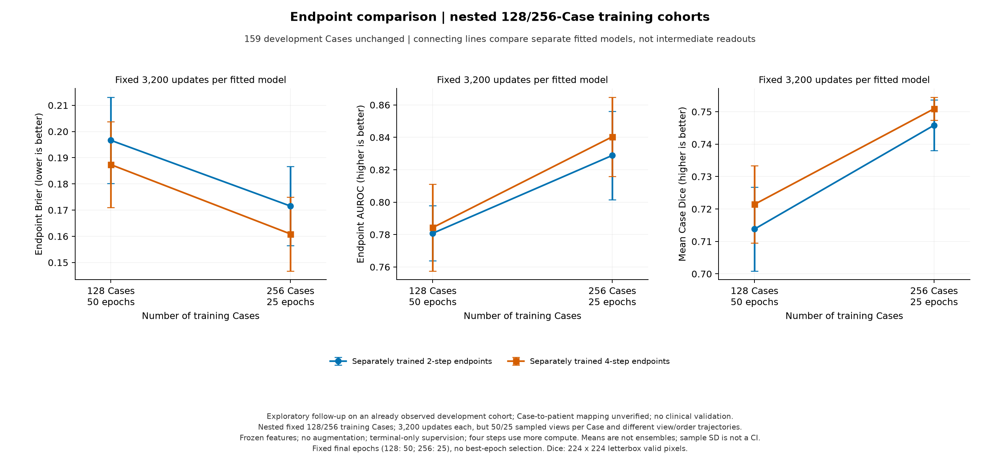
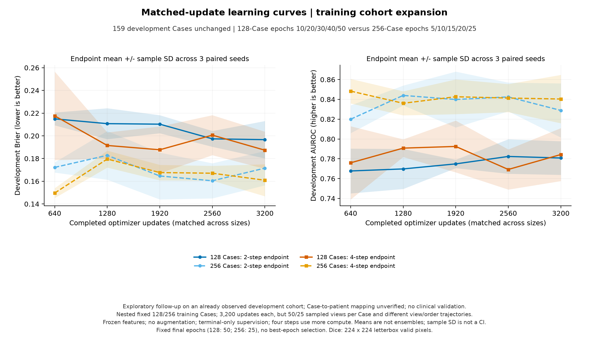

# CPU 扩大到 256 Case：固定更新预算的结果

结果整理日期：2026-10-11。完成 256 Case、仅末步监督、两步/四步、17/29/43 三个种子的六次全新训练。比较原三个种子的六个 128 Case 末步监督模型；此前新五种子复核保持独立，不混作这个配对参照。

**256 Case 的六次 CPU 训练已完成。相对严格匹配的 128 Case 参照，两步和四步在三个种子上的 Brier、AUROC、Dice 均向好；但诊断 Brier/NLL 的条件区间仍跨零。额外循环的平均 Brier 收益为 +0.01064，两个种子改善、一个变差，区间跨零。当前最稳妥的结论是扩充病例出现正向信号，尚未证明循环收益更可靠或随规模增强。**

## 两种规模的独立训练终点

128 Case 取预定第 50 epoch，256 Case 取预定第 25 epoch，均完成 3,200 updates、6,400 次 Case 训练接触。下列均值±样本标准差来自三个独立拟合指标，不是预测集成。

| 训练 Case | 深度 | Brier ↓ | AUROC ↑ | NLL ↓ | Dice ↑ | 平均敏感度 / 特异度（阈值 0.5） |
|---|---|---:|---:|---:|---:|---:|
| 128 | 2 步 | 0.1966 ± 0.0165 | 0.7808 ± 0.0170 | 1.2727 ± 0.1133 | 0.7138 ± 0.0129 | 0.4444 / 0.9105 |
| 128 | 4 步 | 0.1873 ± 0.0163 | 0.7843 ± 0.0267 | 1.1545 ± 0.1284 | 0.7214 ± 0.0119 | 0.5556 / 0.8827 |
| 256 | 2 步 | 0.1715 ± 0.0151 | 0.8289 ± 0.0273 | 1.0401 ± 0.1365 | 0.7458 ± 0.0078 | 0.5686 / 0.8951 |
| 256 | 4 步 | 0.1609 ± 0.0141 | 0.8404 ± 0.0244 | 0.9964 ± 0.2274 | 0.7509 ± 0.0036 | 0.5621 / 0.9321 |

Brier/NLL 越低越好，AUROC/Dice 越高越好。概率质量、诊断排序、轮廓和固定阈值操作点分别评价。

## 256 Case 中四步相对两步的收益

G₂₅₆ = Brier（独立两步最终输出）− Brier（独立四步最终输出），正值有利于四步。配对数据规模/深度交互为 G₂₅₆−G₁₂₈。

| 种子 | 256 两步 Brier | 256 四步 Brier | G₂₅₆ | G₁₂₈ | G₂₅₆−G₁₂₈ |
|---|---:|---:|---:|---:|---:|
| 17 | 0.18744 | 0.16485 | +0.02259 | +0.01099 | +0.01161 |
| 29 | 0.15740 | 0.17260 | -0.01520 | +0.00374 | -0.01894 |
| 43 | 0.16977 | 0.14523 | +0.02454 | +0.01312 | +0.01142 |

G₂₅₆ 平均 +0.01064，条件区间 [-0.01277, +0.03377]，种子方向为正、负、正。种子 29 的两步模型在 Brier/NLL/AUROC/Dice 上均优于四步；这是真实反例，应保留。

原匹配三个种子的 G₁₂₈ 为 +0.00928，本轮 G₂₅₆−G₁₂₈ 为 +0.00136，区间 [-0.02973, +0.03226]，没有清晰增强或减弱证据。不能拿此前五个不同种子的 +0.04618 直接作配对数据规模参照。四步相对两步的 NLL 平均变化 -0.04374，区间 [-0.22479, +0.13383]，也是两个改善、一个恶化。

配对 Case bootstrap 使用同一开发 Case、拟合种子和深度的对应效应；先在每个 Case 内平均三个种子，再重采样 159 个 Case，2,000 次，bootstrap 种子 17。区间条件于已训练模型，不包含训练种子总体不确定性。不能把 3×159 个预测当成独立患者。

## 扩充病例对每种深度的影响

| 深度 | Brier₁₂₈−Brier₂₅₆ | 条件 Case 95% 区间 | 平均 AUROC₂₅₆−AUROC₁₂₈ | Dice₂₅₆−Dice₁₂₈ | Dice 条件区间 |
|---|---:|---|---:|---:|---|
| 2 步 | +0.02509 | [-0.00701, +0.06060] | +0.04805 | +0.03202 | [+0.01825, +0.04630] |
| 4 步 | +0.02645 | [-0.00361, +0.05750] | +0.05604 | +0.02948 | [+0.01740, +0.04286] |

两种深度的三个匹配种子，扩大病例后都降低 Brier、提高 AUROC 和 Dice，提供方向一致的探索性信号。但两条数据规模 Brier 收益区间均含零；NLL 收益区间也含零。轮廓 Dice 数据规模变化的条件区间为正，这是分割任务的证据，不能替代良恶性判断或临床效用证据。

两步平均 NLL 从 1.2727 到 1.0401，四步从 1.1545 到 0.9964。四步种子 17 的 NLL 反而从 1.09045 到 1.12882，因此不能说所有指标在每个种子都改善。两种模型最终 NLL 都仍高于常数基线 0.6274，概率质量仍需进一步检查；本轮尚未进行概率校准验证。

本轮固定总更新数，更多不同训练 Case 与每 Case 较少接触同时发生；初始化虽匹配，跨规模的病例顺序和视图抽样也改变。这个比较不识别纯数据量机制。

## 相同更新次数下的学习曲线与误差诊断

新 epoch 5/10/15/20/25 与旧 epoch 10/20/30/40/50，分别对应 640/1,280/1,920/2,560/3,200 updates。旧记录中的其他时点没有被删除，仅不用于该对齐图。不能按同一 epoch 比较，也没有事后选择更好的终点。

| 256 Case 种子 | 高置信错误：两步 / 四步 | 分类纠正 / 恶化 | NLL₄−NLL₂ | AUROC₄−AUROC₂ |
|---|---:|---:|---:|---:|
| 17 | 20 / 15 | 12 / 4 | -0.06832 | +0.02251 |
| 29 | 16 / 17 | 6 / 15 | +0.15304 | -0.00399 |
| 43 | 15 / 13 | 19 / 7 | -0.21593 | +0.01598 |

高置信错误指恶性 Case 的 p≤0.05 或良性 Case 的 p≥0.95。256 Case 的六个最终模型均未出现 Case 平均概率精确为 0 或 1，但仍有高置信错误；种子 29 四步为 17 个，比两步的 16 个更多。

| 深度 | 128 平均训练 Brier | 256 平均训练 Brier | 128 开发−训练 Brier | 256 开发−训练 Brier |
|---|---:|---:|---:|---:|
| 2 步 | 0.00000107 | 0.00020747 | 0.19662 | 0.17133 |
| 4 步 | 0.00000175 | 0.00113311 | 0.18734 | 0.15976 |

训练/开发差距下降，但训练集合与每 Case 接触次数也改变；不能只根据差距就识别过拟合的原因。事后观察已固定的共同更新时点：256 四步在 640 updates 的平均 Brier/NLL/AUROC 为 0.14961/0.48811/0.84834，到 3,200 为 0.16089/0.99635/0.84035；Dice 同期由 0.64176 升到 0.75092。概率指标与轮廓指标呈不同走势，提示训练终点值得研究；尚未通过损失或梯度对照识别原因，也不是选择 640 为新主终点的依据。

病例纠正/恶化数比较的是两个分别训练模型的最终预测，不证明同一循环内部纠错。末步监督的中间读出没有直接监督，只作诊断。

## 重新拟合的训练限定基线

| 训练 Case | 固定控制 | 开发 Brier | 开发 AUROC | 开发 NLL |
|---|---|---:|---:|---:|
| 128 | 常数概率 | 0.2179 | 0.5000 | 0.6274 |
| 128 | 冻结特征线性分类器 | 0.2584 | 0.6761 | 1.3303 |
| 256 | 常数概率 | 0.2179 | 0.5000 | 0.6274 |
| 256 | 冻结特征线性分类器 | 0.2273 | 0.7066 | 1.0113 |

固定线性分类器同样在更多训练病例后改善：Brier 从 0.2584 到 0.2273、AUROC 从 0.6761 到 0.7066。因此更多病例的方向性收益不专属于循环 Transformer。256 的线性模型是重新拟合，而不是复用旧权重。

两个规模的线性模型分别用自身训练 Case 拟合 StandardScaler 和固定 C=1 的 logistic regression，max_iter=2,000，seed=17；没有使用 tune 调参数或阈值。它先平均所有视图特征，循环模型训练每 Case 抽一张图、评估平均视图概率，聚合方式有差异。常数基线的训练比例 41/128 与 82/256 相同。

## 执行与下一步判断

两个 worker 各完成三次新拟合，均正常退出；每个 worker 两个 PyTorch 线程。新拟合累计 19,200 次更新，原六个模型只作为已验证参照，不计为新的训练。记录的 worker 计时为 345.1 秒、433.1 秒，较长一路约 7.2 分钟；不含准备阶段的新特征编码/基线拟合，也不是架构速度比较。

333 项测试、41 项子测试通过。实际六个新模型加六个参照的逐图/Case 记录、嵌套关系、初始化、来源、25/50 轮完整历史、3,200 updates 及同更新曲线均已核对；基线指标也从本地记录重新计算。独立只读数学与来源复核通过，两张实际 PNG 完成视觉检查。

256 子集包含 174 良性、82 恶性、445 张图；原 128 子集包含 87 良性、41 恶性、227 张图，病例/视图/标签的实际嵌套关系已复核。开发集仍为 159 Case、281 张图，108 良性、51 恶性。相同规模内两步/四步初始化和抽样配对，跨规模初始化相同，抽样轨迹不同。

模型仍为 714,530 个可训练参数，冻结编码器 5,717,416 个参数。25 epoch、batch size 2、学习率 0.0003、AdamW weight decay 0.01、联合分类/轮廓损失和梯度裁剪保持原配方，无增强、指纹绑定的冻结特征缓存。四步允许额外计算，这不是等 FLOPs 比较。

建议继续留在 CPU 阶段。若目标是回答“循环收益是否在更多病例下稳定”，最直接的后续是保持 256 Case 和 3,200 updates，补齐此前固定的新五个种子，与它们已有的 128 Case 模型严格配对。这可进一步检验种子 29 的反例和数据规模交互，仍不会增加独立开发病例。

若目标转向概率质量，另一条独立路线是预先固定正则/训练终点或校准对照；曲线已显示概率与轮廓指标呈不同走势，但本轮没有识别这种差异的机制。两条路线应各自锁定方案，不同时改变。现有数据不足以直接扩大 GPU 投入，也不应仅凭更高的平均 AUROC 把本轮称为临床成功。本次授权的 256 Case 扩充已全部完成。

本轮未新增硬性成功门槛，也未启动 585 Case、GPU 或临床验证。Case 与患者身份对应仍未核实，tune 已在先前观察过；cal/test 没有编码、预测或用于校准/选择模型。NLL 保持 epsilon=1e−15 裁剪，数值受极端概率饱和影响。此结果不建立临床效用、外部泛化或内部纠错机制。

执行前方案见 [扩充方案](CPU_CASE_EXPANSION_PLAN.md)，配置见 [256 Case CPU 配置](../configs/cpu_case_expansion256.json)，汇总和图见 [公开结果](../reports/case_expansion256/)。原始影像、逐病例预测、缓存和权重留在本地；旧报告保持原样。
