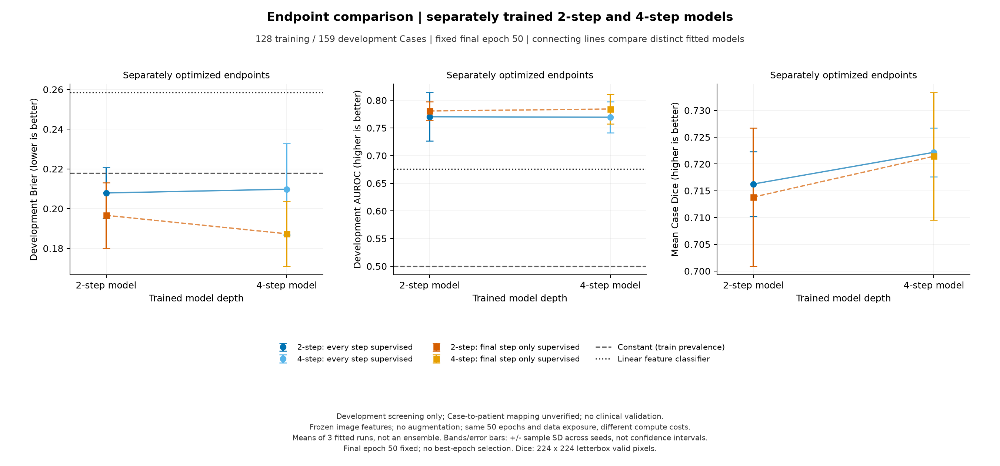
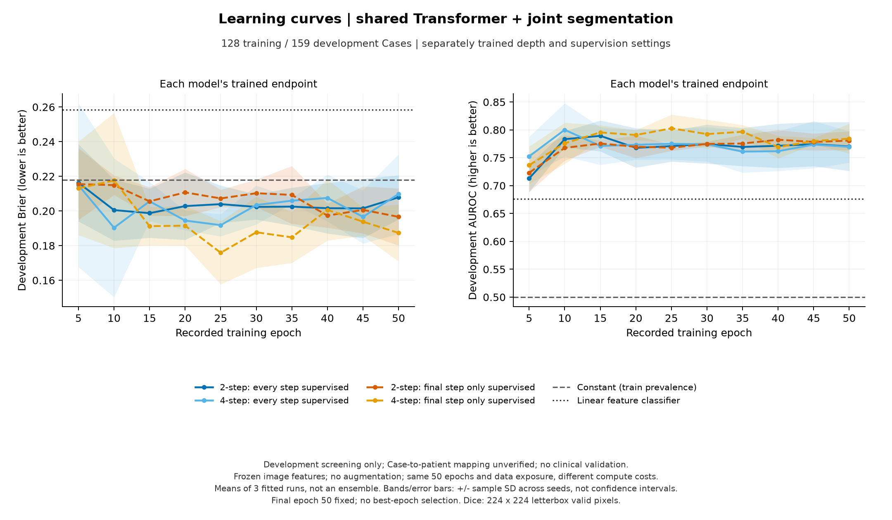

# CPU 对照结果：独立训练深度 × 监督位置

结果整理日期：2026-10-11。使用与上一轮相同的 128 个训练 Case、159 个 tune Case。共享循环＋联合分类/分割监督固定，比较两步/四步以及每步/仅末步监督，三个随机种子，十二次全新训练。

**最近这一步已经完成：12 次 CPU 训练、严格配对分析和结果复核均通过。仅末步监督下，独立四步模型的 Brier 在三个种子上都优于独立两步模型，平均降低 0.00928；但配对区间跨零。每步监督下的深度收益不一致。当前结论是值得复核的方向性信号，尚未证明额外循环稳定有益。**

## 最终读出结果

统一报告第 50 epoch；数字为三个独立种子的均值±样本标准差。这里的两步、四步是分别训练的模型，不是一个四步模型中的两个读出。

| 训练深度 | 监督位置 | Brier ↓ | AUROC ↑ | NLL ↓ | Dice ↑ |
|---|---|---:|---:|---:|---:|
| 2 步 | 每步监督 | 0.2079 ± 0.0127 | 0.7703 ± 0.0437 | 1.4260 ± 0.1184 | 0.7163 ± 0.0060 |
| 4 步 | 每步监督 | 0.2098 ± 0.0229 | 0.7695 ± 0.0281 | 1.7699 ± 0.7134 | 0.7222 ± 0.0045 |
| 2 步 | 仅末步监督 | 0.1966 ± 0.0165 | 0.7808 ± 0.0170 | 1.2727 ± 0.1133 | 0.7138 ± 0.0129 |
| 4 步 | 仅末步监督 | 0.1873 ± 0.0163 | 0.7843 ± 0.0267 | 1.1545 ± 0.1284 | 0.7214 ± 0.0119 |
| — | 常数基线（单次固定拟合） | 0.2179 | 0.5000 | 0.6274 | — |
| — | 冻结特征线性基线（单次固定拟合） | 0.2584 | 0.6761 | 1.3303 | — |

所有四种模型都用共享 Transformer 循环、同时学习良恶性和轮廓；这轮只改变训练深度和监督位置。两条基线在相同训练/开发 Case 上沿用原先固定拟合；线性基线先平均视图特征，循环模型先预测各视图再平均概率，聚合方式有差异。表内均值是分别计算三个模型的指标后求平均，不是预测集成。

Brier 为主要概率预测误差，越低越好。AUROC 衡量诊断排序，NLL 更重地惩罚错误且非常确定的预测；分割 Dice 是不同的任务。NLL 沿用 epsilon=1e−15 裁剪，其数值受极端概率饱和影响。

## 额外循环的收益与监督交互

对每种监督位置，G=Brier（独立训练两步的最终输出）−Brier（独立训练四步的最终输出），正值有利于四步。交互量为 G_terminal−G_all。

| 比较 | 平均收益 | 配对 Case 95% 区间 | 种子 17 | 种子 29 | 种子 43 |
|---|---:|---|---:|---:|---:|
| 每步监督：两步 → 四步 | -0.00189 | [-0.02973, +0.02572] | +0.01346 | +0.02223 | -0.04136 |
| 仅末步监督：两步 → 四步 | +0.00928 | [-0.01453, +0.03473] | +0.01099 | +0.00374 | +0.01312 |
| 交互：末步收益 − 每步收益 | +0.01117 | [-0.01529, +0.03608] | -0.00247 | -0.01850 | +0.05447 |

每步监督下两个种子改善、一个变差，均值 −0.00189，不能说四步稳定优于两步。仅末步监督下三个种子均改善，均值 +0.00928，但 95% 条件区间为 [−0.01453, +0.03473]，仍允许无收益或负收益。

交互量虽为正，逐种子方向却为负、负、正，正均值主要受种子 43 影响；不能据此认定中间监督造成原先的负向现象。仅末步监督的 AUROC 平均从 0.7808 到 0.7843，三个种子中只有两个改善；概率误差改善和诊断排序改善需要分别评价。四步仅末步模型 NLL 为 1.1545，仍高于常数基线 0.6274，概率质量还有明显问题。这不是已完成的概率校准实验。

配对 Case bootstrap 先在每个 Case 内平均三个种子的效应，再重采样 159 个 Case，2,000 次。区间条件于这三个已训练模型，不包含训练随机性的总体不确定性。没有把同一 Case 的三个预测当成三个患者；标准差也不是置信区间。

## 与上一轮现象如何对应

| 同一四步模型中，第 2 → 4 步 | Brier₂−Brier₄ | Dice₄−Dice₂ | 第 2 步是否直接监督 |
|---|---:|---:|---|
| 每步监督 | -0.01088 | +0.00208 | 是 |
| 仅末步监督 | +0.02634 | +0.03571 | 否 |

上一轮“同一个每步监督四步模型，从第 2 步到第 4 步 Brier 变差”仍精确出现：三个种子都变差，平均 Brier 增加 0.01088，Dice 则平均增加 0.00208。本轮每步监督四步模型与上一轮对应模型的逐病例预测、完整训练历史及参数张量精确一致，属于全新拟合后的确定性重放核验，不能当作额外独立种子。

新增的公平短模型对照改变了解读：分别训练四步相对两步，仅一个种子变差。因此上一轮的三个负向中间变化，不能被解释为“训练更多循环必然无用”。末步监督内部第 2→4 步看起来改善，但第 2 步没有直接监督，这也不能代替独立两步模型的对照。

两种比较对应不同问题。独立训练的短模型只有较短的训练轨迹；四步模型的第二步读出受同一模型后续步骤的训练目标影响。末步监督模型的中间读出没有直接训练，只能作诊断性观察。

本轮的监督位置同时改变分类和 mask 损失的位置，尚不能单独识别分类辅助监督与分割辅助监督的作用。监督交互也不等于已证明内部“纠错”机制。

## 学习曲线与资源

十二次拟合均完整运行 50 epoch，累计 38,400 次优化更新。两路 CPU worker 各完成六次拟合、各用两个 PyTorch 线程；冻结特征直接复用，经编码器/图像/预处理指纹核验，所有模型权重重新初始化。记录的 worker 运行计时分别为 1348.4 秒和 880.8 秒；较长一路约 22.5 分钟，不含先前数据准备/特征编码。并发竞争、中间头计算和阶段性评估都会影响时间，不能作为模型速度比较。

曲线显示后半程开发指标没有随 epoch 单调改善；统一使用预定第 50 epoch，没有事后挑选更好的终点。运行前相关损失/梯度、配对初始化、执行保护和分析检查共 203 项测试、41 项子测试通过。完成后另从逐病例记录重算端点指标并核对所有病例、视图和标签，独立只读复核通过。

四种设置均为 714,530 个可训练参数，冻结编码器另有 5,717,416 个参数。每组 50 epoch、3,200 次更新，每 Case 50 次训练接触；同一种子的四种设置使用相同初始权重、病例顺序和视图抽样。学习率 0.0003、batch size 2、无增强、特征缓存，均在运行前锁定。

每步监督平均各步相同的分类＋分割损失；末步监督只用最后一步，不再除以深度，梯度仍穿过所有循环。不同监督模式的训练损失不是同一个目标，不能直接排名。四步允许额外计算；这不是等 FLOPs 比较，也没有为各设置寻找最优超参数。

## 能得出什么，下一步是什么

这一步补齐了最关键的对照缺口：我们现在确实比较了分别训练好的两步和四步模型。可以保留“末步监督四步模型有正向概率误差信号”作为后续假设；无法据此确认循环的普遍优势，也无法确认逐轮纠错机制。

下一步建议继续做有边界的 CPU 验证：先核实患者级分组，按固定方案增加训练种子，并检查四步每步监督下种子 43 的极端置信预测；如加入正则或校准，应事先固定训练/校准数据用途与评估规则。只在需要解冻编码器、在线图像增强或更大输入时升级 GPU。正式确认必须使用妥善分组、未被反复观察的评估数据；当前结果不足以直接扩大 GPU 投入。

这轮 tune 集已经在上一轮观察过，因此属于探索性后续实验。Case 与患者身份的对应尚未核实。校准集、测试集没有预测或用于选择结果；阈值仍固定 0.5，临床净获益和外部泛化均未验证。

完整方法见 [执行前方案](CPU_DEPTH_SUPERVISION_PLAN.md)，配置见 [CPU 配置](../configs/cpu_depth_supervision128.json)，汇总见 [公开数据](../reports/depth_supervision128/)。旧报告保持原样；原始影像、逐病例预测、缓存与权重留在本地。
