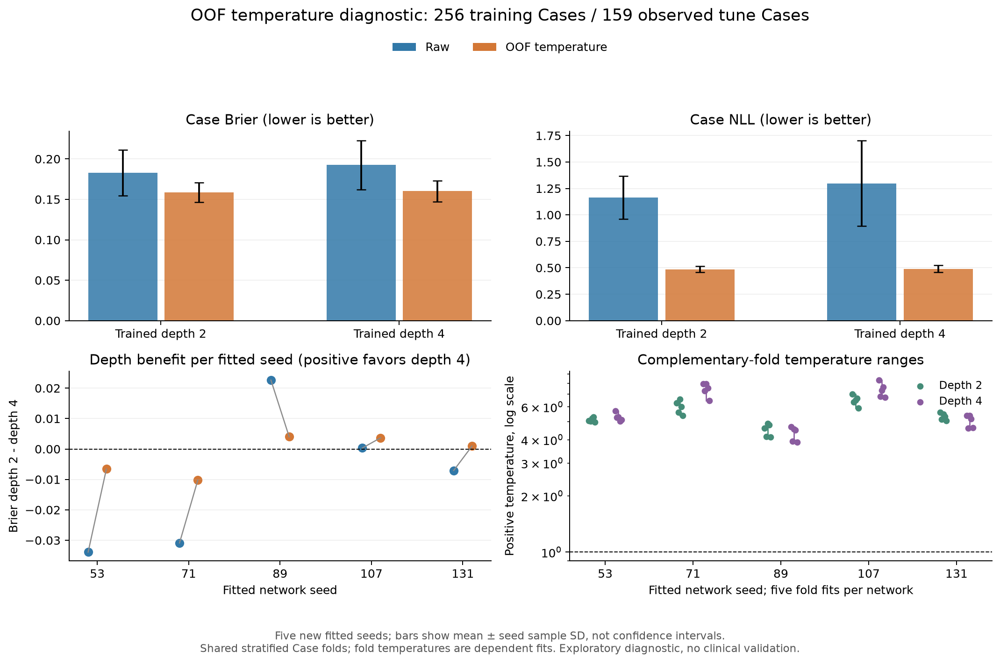
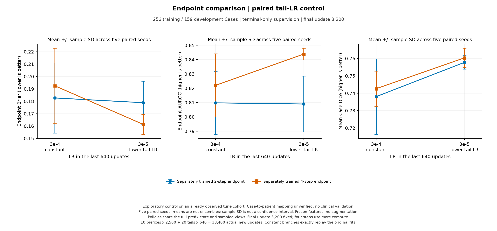
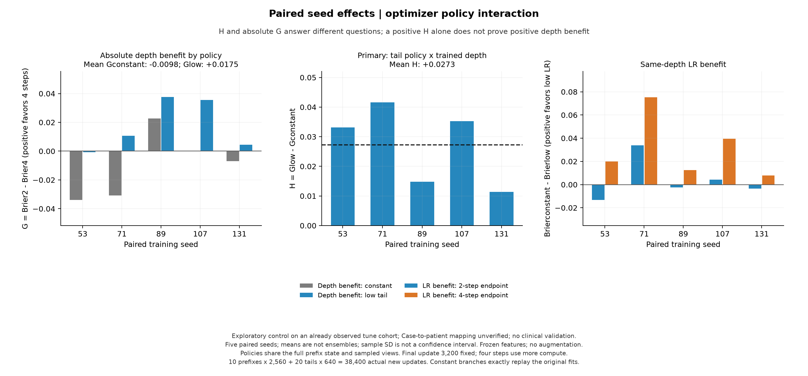
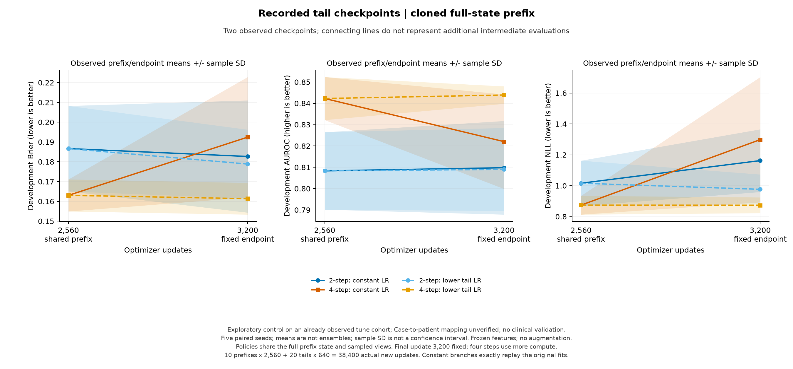

# CPU 两项验证：概率尺度与末期学习率

结果日期：2026-10-11。依据用户授权完成执行前方案的第一、第二步。温度诊断使用固定模型与已观察的开发Case；训练干预保持相同病例、固定更新数和终点。两项各自报告，未把第一部分的OOF概率用于第二部分的原始概率主指标。

两项完成后，当前问题可以收窄为：**共享循环在良恶性预测中的概率收益是否依赖末期优化配方？** 原始恒定学习率下，256 Case四步Brier平均更差；只对已有概率做温度处理后，两步/四步差距接近零。独立的训练干预中，固定降低最后640次更新的学习率，四步相对自身恒定分支的Brier在5/5种子改善，低学习率配方下四步相对两步在4/5种子改善。主交互H=+0.02725，绝对低末期学习率深度收益G=+0.01749；两者的条件Case区间均在零以上。这是继续研究的探索信号，尚未在独立患者上复现。

## 第一部分：已有模型的交叉拟合温度诊断

主分析为256 Case训练的五个既定种子53/71/89/107/131、独立两步/四步终点；匹配的128 Case模型仅作次要诊断。159个开发Case共同分为5个分层折，种子20261011。每个模型在其余4折拟合正温度、预测留出折，先平均视图概率再取Case logit。共20个固定网络、100次温度拟合、3,180条本地OOF Case记录。

| 256训练Case模型 | 概率处理 | Brier ↓ | NLL ↓ | 合并Case AUROC ↑ |
|---|---|---:|---:|---:|
| 2步 | 原始 | 0.1827 ± 0.0283 | 1.1626 ± 0.2029 | 0.8098 ± 0.0220 |
| 2步 | 交叉拟合温度 | 0.1585 ± 0.0123 | 0.4864 ± 0.0286 | 0.8038 ± 0.0258 |
| 4步 | 原始 | 0.1924 ± 0.0304 | 1.2983 ± 0.4054 | 0.8220 ± 0.0222 |
| 4步 | 交叉拟合温度 | 0.1602 ± 0.0129 | 0.4898 ± 0.0328 | 0.8098 ± 0.0294 |

均值±样本标准差描述五个网络，未集成预测。两种深度平均概率损失都改善；两步seed53的Brier反而增加0.00252，是保留的反例。主分析四步Brier在5/5模型降低，两步在4/5降低，NLL两组均5/5降低。

| 深度 | 原始−OOF Brier | 条件Case区间 | 原始−OOF NLL | 条件Case区间 |
|---|---:|---|---:|---|
| 2步 | +0.02414 | [+0.00910, +0.03989] | +0.67615 | [+0.37997, +0.98939] |
| 4步 | +0.03226 | [+0.01493, +0.05014] | +0.80852 | [+0.50577, +1.13971] |

| 诊断组别 | 原始G（Brier₂−Brier₄） | OOF G | OOF条件区间 | OOF正收益种子 |
|---|---:|---:|---|---:|
| 256 Case主诊断 | -0.00976 | -0.00164 | [-0.01237, +0.00916] | 3/5 |
| 128 Case次诊断 | +0.04618 | +0.03312 | [+0.01626, +0.04858] | 5/5 |

256 Case的原始四步劣势在温度处理后缩小，但OOF深度收益仍接近零且区间跨零；128次诊断的正向深度差距没有完全被温度缩放消除。这个诊断支持输出概率尺度值得处理，未恢复256 Case中四步的稳定优势。

所有100个温度均大于1，没有选择identity或边界。256主诊断两步温度范围4.125–7.015，四步3.883–8.346。拟合范围固定log(T)∈[-4,4]、目标为稳定softplus NLL、xatol=1e−10、maxiter=1000，包含T=1及两个端点；报告NLL沿用概率epsilon=1e−15裁剪，拟合与报告数值政策分别保留。

不同折使用不同温度，合并OOF AUROC可以变化，不能把变化解释为重新学习表征。主诊断10个网络的合并AUROC都下降。0.5阈值下每个Case的良恶性判别及敏感度/特异度保持不变；OOF概率改善不等于减少分类错误或已验证临床效用。

## 第二部分：固定末期学习率的共享前缀控制

256训练Case、159开发Case、同五个种子、末步联合监督和模型均保持原配方。每个seed/depth重新训练前20轮（2,560更新）学习率3e−4，保存完整模型/AdamW/Python/NumPy/Torch RNG/loader generator/CaseViewSampler状态，再独立恢复到constant与low_tail两条末5轮分支。low_tail最后640更新固定3e−5，constant仍3e−4。所有分支固定第25轮、3,200更新终点，未选择较好的前缀结果。

| 深度 | 末段学习率 | Brier ↓ | AUROC ↑ | NLL ↓ | Dice ↑ | 平均敏感度 / 特异度（0.5） |
|---|---|---:|---:|---:|---:|---:|
| 2步 | 3e−4恒定 | 0.1827 ± 0.0283 | 0.8098 ± 0.0220 | 1.1626 ± 0.2029 | 0.7380 ± 0.0217 | 0.5294 / 0.9093 |
| 4步 | 3e−4恒定 | 0.1924 ± 0.0304 | 0.8220 ± 0.0222 | 1.2983 ± 0.4054 | 0.7426 ± 0.0101 | 0.4471 / 0.9315 |
| 2步 | 3e−5末段 | 0.1789 ± 0.0174 | 0.8090 ± 0.0195 | 0.9767 ± 0.0963 | 0.7577 ± 0.0039 | 0.5608 / 0.8778 |
| 4步 | 3e−5末段 | 0.1614 ± 0.0080 | 0.8439 ± 0.0041 | 0.8738 ± 0.0509 | 0.7603 ± 0.0056 | 0.6000 / 0.9167 |

第二部分以上均为未校准的原始概率，不能直接与第一部分的OOF概率当作同一流程比较。

## 深度特异交互与绝对循环收益

G_policy = Brier₂−Brier₄，正值有利于四步。主交互H = G_low_tail−G_constant，也等于四步的政策改善减去两步的政策改善；H为正不自动证明G_low_tail为正。

| 种子 | constant G | low_tail G | H | 两步Brier改善（constant−low） | 四步Brier改善（constant−low） |
|---|---:|---:|---:|---:|---:|
| 53 | -0.03388 | -0.00071 | +0.03317 | -0.01320 | +0.01997 |
| 71 | -0.03087 | +0.01076 | +0.04163 | +0.03378 | +0.07541 |
| 89 | +0.02266 | +0.03752 | +0.01485 | -0.00237 | +0.01248 |
| 107 | +0.00032 | +0.03553 | +0.03521 | +0.00437 | +0.03958 |
| 131 | -0.00705 | +0.00436 | +0.01141 | -0.00344 | +0.00796 |

主交互H平均+0.02725，条件区间[+0.00979, +0.04596]，正收益种子5/5。

constant G平均-0.00976，条件区间[-0.02967, +0.01060]，正收益种子2/5。

low_tail G平均+0.01749，条件区间[+0.00171, +0.03376]，正收益种子4/5。

| 深度 | 政策Brier改善 | 条件区间 | NLL变化（low−constant，负值更好） | 条件区间 | 平均AUROC变化 | 平均Dice变化 |
|---|---:|---|---:|---|---:|---:|
| 2步 | +0.00383 | [-0.00867, +0.01704] | -0.18588 | [-0.29801, -0.07706] | -0.00078 | +0.01970 |
| 4步 | +0.03108 | [+0.01503, +0.04784] | -0.42454 | [-0.58391, -0.26947] | +0.02186 | +0.01772 |

结果支持这个固定训练政策对四步的收益更大：四步Brier改善0.03108，五种子全部为正；两步平均只改善0.00383，区间跨零且仅2/5种子为正。H在5/5种子为正，而low_tail G在4/5为正，seed53仍为−0.00071，保留这个反例。四步AUROC平均从0.8220到0.8439，NLL从1.2983到0.8738，Dice从0.7426到0.7603；AUROC在4/5种子升高、seed131略降，NLL及Dice在5/5种子改善。

这不是所有模型都因较小学习率而同样改善，也没有证明多循环普遍有效。它说明原先256 Case中四步的负结果对这个末期优化政策敏感，应把循环深度与优化政策一起研究。使用统一学习率是可比的配方控制，却不保证各深度都处于适合的训练状态；本轮只有两个预先固定的政策，尚未确定各深度的最优配方。low_tail中四步相对两步的NLL变化区间为[−0.21736, +0.00879]、Dice变化区间为[−0.00396, +0.00933]，两者均跨零；上述四步5/5的NLL/Dice改善指相对constant四步，不能混同为相对low_tail两步的稳定优势。

## 前缀到终点与错误诊断

四步constant在最后640次更新后，Brier平均恶化0.02941，4/5种子恶化；low_tail相对同一前缀只平均改善0.00168，区间跨零，NLL变化也接近零。因此这次政策收益主要表现为避免原配方的末期退化，还没有证据说明额外末段训练带来了稳定增益。

| 分支 | 前缀−最终Brier | 条件区间 | 最终−前缀NLL | 条件区间 |
|---|---:|---|---:|---|
| 2步 constant | +0.00399 | [-0.00791, +0.01583] | +0.14652 | [+0.04108, +0.25284] |
| 4步 constant | -0.02941 | [-0.04608, -0.01374] | +0.42404 | [+0.25443, +0.59117] |
| 2步 low_tail | +0.00782 | [+0.00096, +0.01509] | -0.03936 | [-0.09351, +0.01189] |
| 4步 low_tail | +0.00168 | [-0.00537, +0.00862] | -0.00050 | [-0.04116, +0.04007] |

| 种子 | 两步高置信错误：constant / low | 四步高置信错误：constant / low |
|---|---:|---:|
| 53 | 15 / 14 | 19 / 14 |
| 71 | 20 / 15 | 30 / 16 |
| 89 | 15 / 14 | 14 / 14 |
| 107 | 26 / 17 | 25 / 14 |
| 131 | 18 / 18 | 17 / 19 |

高置信错误：恶性p≤0.05或良性p≥0.95。seed131四步low_tail的Brier较constant改善，高置信错误却从17增加到19，其中高置信假阴性从11增加到16；平均概率评分改善不保证所有临床相关错误都减少。前缀与终点变化比较训练阶段，不等于同一输入前向传播中增加循环的机制。每轮分类/轮廓损失和裁剪前梯度范数/裁剪比例保留，作为诊断，不单独证明梯度冲突。

## 执行、复核与研究边界

方案/配置在执行前提交并公开，锁定提交为`2e190c34c34ff517a4f058f61e87c2c03132e8e2`。第一部分完成100次拟合；独立复核使用逆温度凸目标的导数求根，温度最大相对差约4.3e−8，OOF记录及bootstrap均复算一致。第二部分两个CPU worker正常退出，分别完成19,200实际新增更新；总计38,400次，十个全新前缀、二十个末段终点。worker运行时间分别744.690和947.523秒，包含各自的训练、评估及文件操作，不含先前数据/特征准备，也不能相加当作并行墙钟时间。

十个constant分支均精确重放此前对应模型的参数张量、训练目标、开发历史及逐图预测；它们作为配对对照，没有增加独立种子数。完整状态恢复及采样指纹、原始记录到Case指标、主交互和区间均接受独立复核。核心训练源、编码器、影像清单及队列指纹保持固定。代码通过464项测试和41项子测试（8.21秒），包含新旧日志公共字段比较的回归检查。科学图从公开汇总生成，逐张检查实际结果图；执行指纹与检查见[执行记录](../reports/tail_lr256/execution_summary.json)。

两项均在此前观察的159 Case上做探索；Case与患者身份的一一对应尚未核实。第一部分区间条件于网络、温度拟合和分折，第二部分条件于网络和配对分支；均先在每个Case内平均五个种子效应，再重采样Case，2,000次、种子17。没有新增独立评估患者，也不包含训练种子总体不确定性。

温度只处理输出尺度；AdamW学习率同时改变梯度和解耦权重衰减的更新量。共享前缀保证相同起点和抽样，不能识别纯梯度尺度原因。四步计算更多，冻结编码器/无增强/重采样分割指标限制外推；没有等FLOPs架构优势、患者独立临床验证、内部纠错或纯数据规模机制的证明。

下一阶段建议先冻结这次政策及分析口径，再设计新的分组划分或独立队列复核：核实Case与患者对应，避免同一患者泄漏；以同样的两步/四步×constant/low_tail配对设计检查交互是否重现。已观察Case的新划分只能作内部稳健性检查，新的未观察独立队列才能提供独立复核。若要研究分类临床意义，应预先选择实际用途、操作阈值与漏诊/误诊代价，在独立数据评价敏感度、特异度、校准和决策净获益，而不是只追求Brier。当前平均0.5阈值敏感度仍约0.60，不能据此支持临床使用。本次完成授权的两步，没有启动额外病例、打开cal/test或运行GPU。

执行前方案见[两项计划](CPU_PROBABILITY_AND_TAIL_PLAN.md)，配置见[温度配置](../configs/cpu_temperature_diagnostic.json)、[末期学习率配置](../configs/cpu_tail_lr256.json)。汇总与图分别见[温度诊断](../reports/temperature_diagnostic/)与[训练对照](../reports/tail_lr256/)。原始影像、分折身份、OOF/训练逐Case记录、完整状态及权重保留本地。
