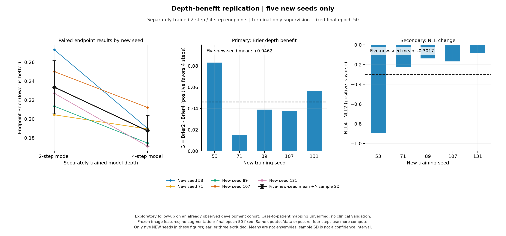
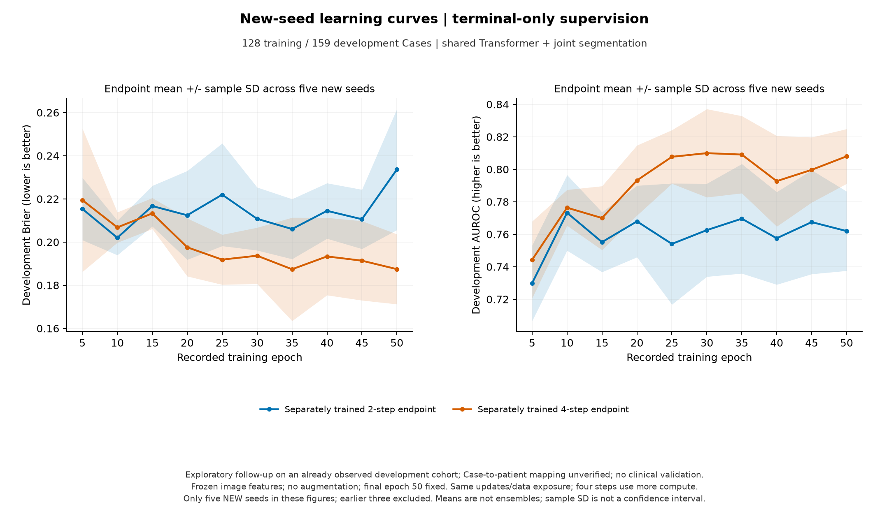

# CPU 五个新种子验证：仅末步监督的深度收益

结果整理日期：2026-10-11。五个预先固定的新种子为 53、71、89、107、131；每个种子分别从头训练两步、四步模型，共 10 次 CPU 拟合。使用原来的 128 个训练 Case、159 个 tune Case。

**建议进入 256 个训练 Case 的 CPU 扩充实验。10 次训练完成，三项运行前推进条件全部通过。五个新种子的四步模型均改善 Brier、AUROC 和 NLL；主要 Brier 收益均值为 +0.04618，条件配对 Case 区间为 [+0.01682, +0.07611]。这是当前配方下的探索性训练随机性复核，尚未证明临床价值或循环内部纠错机制。**

## 五个新种子的主要结果

G = Brier（独立两步模型最终输出）− Brier（独立四步模型最终输出），G > 0 表示四步概率误差较低。所有数字均取预定第 50 epoch，推进规则使用未四舍五入数值。

| 新种子 | 两步 Brier | 四步 Brier | G：四步收益 | AUROC₄−AUROC₂ | NLL₄−NLL₂ |
|---|---:|---:|---:|---:|---:|
| 53 | 0.27320 | 0.19008 | +0.08312 | +0.03477 | -0.89676 |
| 71 | 0.20437 | 0.18937 | +0.01499 | +0.04630 | -0.22691 |
| 89 | 0.21346 | 0.17452 | +0.03894 | +0.02959 | -0.13761 |
| 107 | 0.25004 | 0.21212 | +0.03792 | +0.01189 | -0.16765 |
| 131 | 0.22710 | 0.17116 | +0.05594 | +0.10748 | -0.07945 |

| 独立训练深度 | Brier ↓ | AUROC ↑ | NLL ↓ | Dice ↑ | 平均敏感度（阈值 0.5） | 平均特异度（阈值 0.5） |
|---|---:|---:|---:|---:|---:|---:|
| 2 步 | 0.2336 ± 0.0280 | 0.7620 ± 0.0244 | 1.4752 ± 0.3758 | 0.7260 ± 0.0046 | 0.6039 | 0.7611 |
| 4 步 | 0.1875 ± 0.0162 | 0.8080 ± 0.0168 | 1.1735 ± 0.1766 | 0.7245 ± 0.0054 | 0.5059 | 0.8944 |

均值±样本标准差仅来自五个新拟合模型，不是预测集成。四步的平均 Dice 没有同步提升：变化 −0.00149，区间 [−0.00912, +0.00636]。固定 0.5 阈值下，四步敏感度下降、特异度上升，所以更好的 AUROC/Brier 不能直接当作临床诊断收益。

AUROC 衡量诊断排序，Brier 衡量概率平方误差，NLL 对错误且极端确定的概率处罚更重。轮廓 Dice 是另一个任务。三者分别报告；不能用一个指标代替其他指标。

## 运行前确定的三项推进条件

| 运行前条件 | 实际结果 | 是否通过 |
|---|---|---|
| 至少 4/5 个新种子 G > 0 | 5/5，五个均为正 | 是 |
| 移除任意一个种子，剩余平均 G > 0 | 最小仍为 +0.03695（移除 53） | 是 |
| 平均 NLL₄−NLL₂ ≤ 0 | -0.30168，五个种子都下降 | 是 |

五个 G 的范围为 [+0.01499, +0.08312]。去掉收益最大的种子 53，平均收益仍为 +0.03695，因此正均值没有完全依赖这个种子。五个新种子的主要结果自身通过规则，未用旧三个正向种子帮助通过。NLL 平均变化 -0.30168，条件区间 [-0.58343, -0.03994]。

这些是资源筛选规则，不是显著性检验、概率校准、临床有效性或 GPU 投入的证明。它们只判断是否值得审查另一个扩大训练病例的 CPU 实验，不自动启动扩充。

配对 Case bootstrap（2,000 次，种子 17）先在每个 Case 内平均五个拟合种子的效应，再重采样 159 个 Case。区间条件于五个已训练模型，不能把 5×159 个预测当作独立患者，也不包含训练种子总体不确定性。标准差是五个拟合指标的样本标准差，不是置信区间。

## 错误、极端概率与学习曲线

| 新种子 | 高置信错误数：两步 → 四步 | 分类纠正 / 恶化数 | 精确 0/1 概率数：两步 → 四步 |
|---|---:|---:|---:|
| 53 | 25 → 18 | 33 / 18 | 4 → 0 |
| 71 | 21 → 20 | 12 / 6 | 0 → 0 |
| 89 | 17 → 16 | 8 / 5 | 0 → 0 |
| 107 | 21 → 23 | 21 / 16 | 2 → 0 |
| 131 | 21 → 17 | 22 / 4 | 0 → 0 |

高置信错误定义为恶性 Case 的 p≤0.05，或良性 Case 的 p≥0.95。四步的高置信错误在四个种子下降，但种子 107 从 21 增至 23，虽然该种子的 Brier/NLL/AUROC 都改善。分类纠正/恶化比较的是两个分别训练模型的最终预测，不能解释为同一模型循环内部的纠错。

跨五个种子平均后的病例概率误差效应中，107 个 Case 改善、52 个恶化。移除最大五个正向贡献 Case 后，描述性平均 G 仍为 +0.03044；主要结果保留所有 159 个 Case。但这不表示每个种子都不受少数病例影响：种子 71 删除其自身最大的五个贡献病例后，描述性 G 变为 −0.01516。

四步的新种子平均 NLL 仍为 1.1735，高于常数基线 0.6274；高置信错误和固定阈值的敏感度仍需继续研究。

两步模型的终点有明显波动：种子 53 的开发 Brier 从第 45 轮 0.20194 升至第 50 轮 0.27320，最终训练 Brier 0.04221；种子 107 从 0.19315 升至 0.25004，但 AUROC 仅从 0.77378 到 0.77424，最终训练 Brier 0.00033。因此不能仅根据开发误差上升就判定优化失败，也不能把概率变化等同于排序变化。

事后曲线描述选择 20–50 轮的后半程窗口：在七个记录点中，四步的平均 Brier 有 7/7 次低于两步。评估时点预先固定，但这个窗口是事后选择的。因此收益并非只在第 50 轮的单个平均点出现；这些曲线观察仍属于次要诊断，不能用来替换锁定终点。两步平均 Brier 第 45→50 轮为 0.21059→0.23364，四步为 0.19138→0.18745。当前收益可能包括这一训练配方下的优化与稳定性差异，不能归因为已经证明的语义纠错机制。

最终训练/开发差距、移除最大正向贡献病例后的变化和中间读出只作诊断。主要评价保留全部 Case，不能删除困难病例后宣称成功。末步监督模型的中间输出未直接监督，不能代替独立训练的两步模型。

## 旧三个种子与八个种子的次要汇总

旧三个末步监督种子的平均 G 为 +0.00928；合并八个种子的平均 G 为 +0.03235，8/8 个方向为正，条件区间 [+0.00938, +0.05568]。

收益幅度变大的来源必须说明：旧四步平均 Brier 为 0.18734，新四步为 0.18745，几乎相同；旧两步为 0.19662，新两步为 0.23364。较大的新 G 很大程度来自新两步拟合表现较差。两组种子不同，这只是描述性对照，不能说新四步模型本身因这次实验而改善。

旧三个种子不参与本轮主要图、主要结果表或推进规则。八个种子的汇总也没有增加独立的开发病例；它不能改变本轮门槛的判断。

## 执行与下一步

两路 CPU worker 各完成五次拟合、各用两个 PyTorch 线程；两路均正常退出。累计 32,000 次优化更新。记录的 worker 运行计时分别为 639.4 秒、814.5 秒，较长一路约 13.6 分钟；不含此前数据准备/编码，且不是架构速度基准。

270 项测试、41 项子测试通过。严格分析从本地逐图记录重算指标，核对全部 Case/视图/标签、所有读出、训练来源、50 轮历史和更新数。独立只读复核也通过。代码与方案已在结果完成前发布；原始预测留在本地。两张实际结果图均完成视觉检查。

训练代码、编码器、manifest、队列和配对初始权重与锁定协议相符。所有设置均为 714,530 个可训练参数，另有 5,717,416 个冻结编码器参数。同一种子的两种深度使用相同病例顺序/视图抽样。无增强、特征缓存、学习率 0.0003、batch size 2、50 epoch；每个模型完成 3,200 次更新。四步允许额外计算，这不是等 FLOPs 比较。

建议下一轮使用**嵌套的 128/256 训练 Case、仅末步监督、两步/四步**，先跑三个种子。保持 3,200 次更新：128 Case 对应 50 epoch，256 Case 对应 25 epoch；这回答固定优化预算下，更多不同训练病例是否保留深度收益、减轻对当前训练配方的敏感性。每 Case 接触次数也随之减少，不能称为所有条件完全相同。原有 128 Case 结果只有在来源、队列和初始化严格匹配时才能作为固定参照。

在另一个执行前方案中锁定病例选择、患者分组依据、评价及推进条件，再运行扩充。本轮已完成的阳性资源筛选支持这一步；当前仍适合 CPU，不需要立即升级 GPU。本轮没有启动扩充或打开 cal/test。

开发集已经在此前实验中观察过；更多种子只复核训练随机性，没有新增独立患者。发布的 Case 分组没有跨 split，Case 与患者身份对应尚未核实。cal/test 没有预测或参与校准、选择模型。NLL 保持 epsilon=1e−15 裁剪，其数值受概率饱和影响。当前工作不建立临床效用、外部泛化或内部纠错机制。

执行前方案见 [新种子方案](CPU_SEED_REPLICATION_PLAN.md)，配置见 [锁定配置](../configs/cpu_seed_replication128.json)，完整汇总和图见 [公开结果](../reports/seed_replication128/)。原始影像、逐病例预测、缓存和模型权重保留本地。
